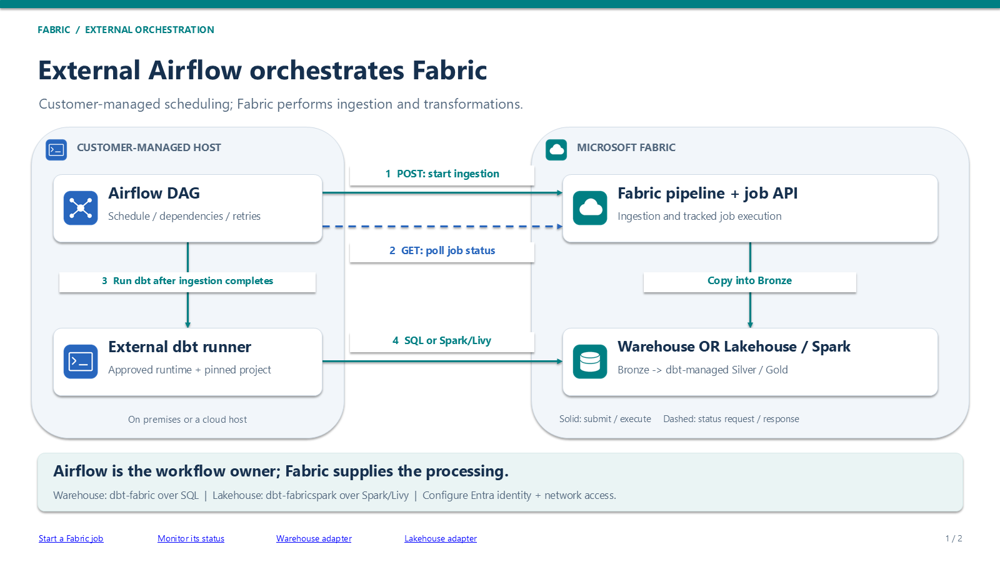
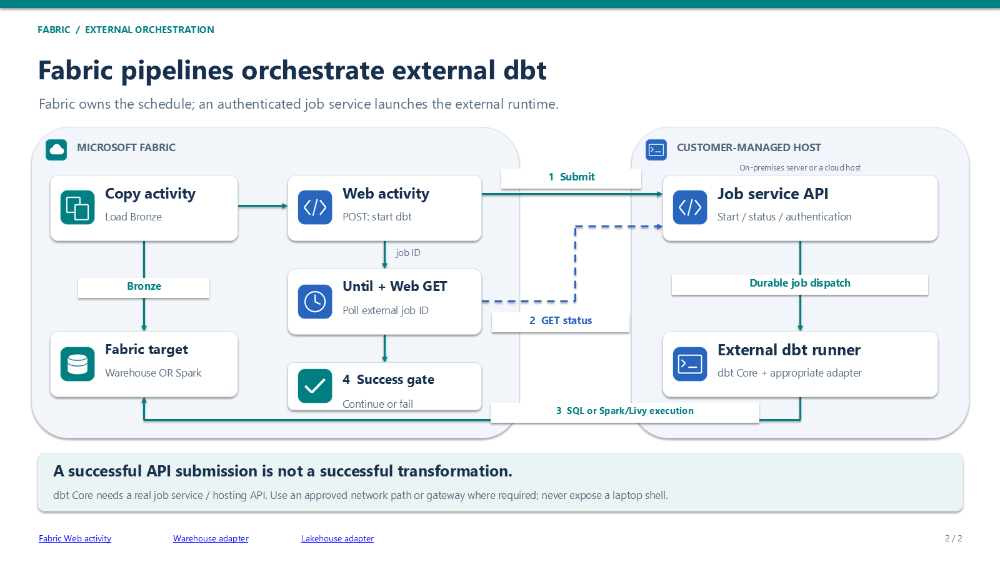

# Fabric API - ETL Orchestration

[Home](../README.md) | [Fabric monitoring](fabric.md)

Official references for building Airflow and dbt orchestration with Microsoft Fabric. Links and key product boundaries reviewed October 22, 2026. This is a reference guide, not a deployed DAG, a support guarantee, or an assertion that every item supports every identity.

## Shareable architecture slides

[Download the two-slide PowerPoint](../assets/Fabric-External-Orchestration-Architecture.pptx) | [PDF](../assets/Fabric-External-Orchestration-Architecture.pdf)

The PowerPoint is generic and contains no customer-specific identifiers. Connections and component labels are editable, documentation links are clickable, and presenter notes explain execution, authentication, and failure-handling boundaries. The PDF is a static sharing copy.

| External Airflow -> Fabric | Fabric pipelines -> external dbt |
|---------------------------|----------------------------------|
|  |  |

## Start here: choose the workflow owner

**Yes: an external orchestrator can invoke supported Fabric workloads through the Fabric REST API and monitor their execution.** It does not have to run inside Fabric.

| Pattern | Workflow owner | Use it when |
|---------|----------------|-------------|
| External Airflow -> Fabric -> external dbt | Airflow schedules the end-to-end DAG, starts Fabric ingestion, waits, then runs or submits dbt | Existing cross-platform dependencies, hosting, or operational controls favor external orchestration |
| External Airflow -> Fabric pipeline with a managed dbt job | Airflow owns the overall DAG; the invoked Fabric pipeline owns its internal activities | dbt should execute in Fabric, while Airflow coordinates the broader workflow |
| Fabric pipeline -> external dbt runner API | Fabric schedules ingestion, submits an external job, and monitors its outcome | Fabric should own the workflow, but dbt needs an external runtime |
| Fabric-hosted Airflow | Fabric hosts Airflow; Python DAGs coordinate workloads | Managed Airflow's current networking, runtime, compute, and regional capabilities fit |

Choose one owner for the top-level schedule, dependencies, retries, and alerts. Calling a Fabric pipeline from Airflow is legitimate layering; independently scheduling the same work in both is not a duplicate-prevention strategy.

For external Airflow plus external dbt, the logical flow is:

```text
Airflow DAG
  -> Submit Fabric ingestion pipeline
  -> Save job-instance URL/ID and wait for Completed
  -> Execute dbt on the approved worker/container, or submit to its job service
  -> Require successful transformations and tests
  -> Run downstream tasks and report the outcome
```

Airflow coordinates work. Fabric's ingestion activities move data. dbt manages model dependencies and tests; Warehouse or Spark executes the transformation queries. Bronze/Silver/Gold are logical layers, not mandatory product assignments. Plan source access and cross-engine movement explicitly.

## 1. Authentication and permissions

| Reference | Use it for |
|-----------|------------|
| [Fabric REST API overview](https://learn.microsoft.com/en-us/rest/api/fabric/articles/get-started/using-fabric-apis) | Establish the automation surface |
| [Fabric API quickstart](https://learn.microsoft.com/en-us/rest/api/fabric/articles/get-started/fabric-api-quickstart) | Token acquisition and a first authenticated request |
| [Fabric identity support](https://learn.microsoft.com/en-us/rest/api/fabric/articles/identity-support) | User, service principal, and managed identity support; the tenant setting that enables application identities |
| [Fabric delegated scopes](https://learn.microsoft.com/en-us/rest/api/fabric/articles/scopes) | Required delegated permissions for user-based access |
| [Microsoft Entra client credentials flow](https://learn.microsoft.com/en-us/entra/identity-platform/v2-oauth2-client-creds-grant-flow) | Non-interactive application authentication |
| [Workload identity federation](https://learn.microsoft.com/en-us/entra/workload-id/workload-identity-federation) | Evaluate supported trust-based authentication without storing an application secret |

Enable the applicable Fabric tenant settings, grant the identity access to the intended workspace/items, and verify the actual workload and downstream connections support it. An API supporting service principals does not establish that every item it invokes does. Delegated scopes describe user-based access; they are not a substitute for app-only authorization.

Keep tokens and credentials out of DAG source, Git, and logs. Use the correct token audience for each service; Fabric REST access, Warehouse SQL access, and Spark/Livy authentication are separate concerns. An external host does not automatically receive an Azure managed identity.

## 2. Start, monitor, troubleshoot, and cancel Fabric runs

| Reference | Use it for |
|-----------|------------|
| [Fabric pipeline REST API capabilities](https://learn.microsoft.com/en-us/fabric/data-factory/pipeline-rest-api-capabilities) | Pipeline-specific create/update/run examples and activity-run diagnostics |
| [Run on-demand item job](https://learn.microsoft.com/en-us/rest/api/fabric/core/job-scheduler/run-on-demand-item-job) | Submit a supported item's job; inspect `Location` and `Retry-After` |
| [Get item job instance](https://learn.microsoft.com/en-us/rest/api/fabric/core/job-scheduler/get-item-job-instance) | Poll one run and inspect its status and `failureReason` |
| [List item job instances](https://learn.microsoft.com/en-us/rest/api/fabric/core/job-scheduler/list-item-job-instances) | Inspect execution history and help reconcile previously submitted runs |
| [Cancel item job instance](https://learn.microsoft.com/en-us/rest/api/fabric/core/job-scheduler/cancel-item-job-instance) | Request cancellation; continue monitoring for the actual outcome |
| [Fabric API throttling](https://learn.microsoft.com/en-us/rest/api/fabric/articles/throttling) | Handle rate limits and backoff |
| [Fabric API pagination](https://learn.microsoft.com/en-us/rest/api/fabric/articles/pagination) | Follow continuation information when listing resources or runs |
| [Fabric long-running operations](https://learn.microsoft.com/en-us/rest/api/fabric/articles/long-running-operation) | Monitor asynchronous control-plane operations such as item creation; not a replacement for job-instance polling |

For a pipeline, the core execution route is:

```http
POST https://api.fabric.microsoft.com/v1/workspaces/{workspaceId}/items/{pipelineId}/jobs/Pipeline/instances
Authorization: Bearer <access-token>
```

The current Job Scheduler reference puts `jobType` in the path. Older pipeline examples use `jobs/instances?jobType=Pipeline`; the Job Scheduler reference explicitly documents backward compatibility. Use the item-specific execution payload and identity guidance rather than treating a generic example as universally applicable. The request's `parameters` property is not supported by every item/job type.

An accepted submission returns `202`, a `Location` for the job instance, and `Retry-After`. Persist the returned reference, wait at least the indicated interval, then poll:

```http
GET https://api.fabric.microsoft.com/v1/workspaces/{workspaceId}/items/{pipelineId}/jobs/instances/{jobInstanceId}
Authorization: Bearer <access-token>
```

| Job status | Orchestrator behavior |
|------------|-----------------------|
| `NotStarted`, `InProgress` | Continue bounded polling, honoring `Retry-After` |
| `Completed` | Allow dependent tasks to proceed |
| `Failed` | Fail the task and retain the error details |
| `Cancelled` | Record cancellation; do not report success |
| `Deduped` | Reconcile with the existing run; this skipped instance is not proof the required work completed |
| Unrecognized status | Record it and fail or escalate explicitly; never assume success |

`202 Accepted` is not success. Cancellation acceptance is not proof cancellation finished. Set an overall timeout, refresh expiring access tokens, and record the Fabric instance ID alongside the Airflow run/task identity.

Do not blindly retry a submission after an ambiguous network failure: it may already have started. Persist submission state and define reconciliation and replay behavior. A correlation ID alone is not an idempotency guarantee.

## 3. Build the external Airflow DAG

These Apache Airflow references describe the building blocks, not a preconfigured Fabric integration. Pin versions compatible with the deployed Airflow runtime.

| Reference | Use it for |
|-----------|------------|
| [DAGs and task dependencies](https://airflow.apache.org/docs/apache-airflow/stable/core-concepts/dags.html) | Schedule and dependency structure for ingestion, transformation, validation, and downstream work |
| [HTTP operators and sensors](https://airflow.apache.org/docs/apache-airflow-providers-http/stable/operators.html) | Submit REST requests and wait for external state; customize token handling, response headers, and terminal-status checks |
| [Managing connections](https://airflow.apache.org/docs/apache-airflow/stable/howto/connection.html) | Configure connection metadata outside DAG code |
| [Secrets backends](https://airflow.apache.org/docs/apache-airflow/stable/security/secrets/secrets-backend/index.html) | Retrieve approved credentials from an external secrets store |
| [BashOperator](https://airflow.apache.org/docs/apache-airflow-providers-standard/stable/operators/bash.html) | Run a controlled dbt CLI command on the Airflow worker when the worker has the approved runtime installed |
| [dbt Cloud operators and sensors](https://airflow.apache.org/docs/apache-airflow-providers-dbt-cloud/stable/operators.html) | Trigger and monitor jobs hosted in dbt Cloud, including asynchronous/deferrable waiting and artifact retrieval |

A generic HTTP task that only checks for a 2xx response does not prove a Fabric job succeeded. Preserve submission response headers, inspect the job's JSON status, and fail promptly for failure/cancellation rather than polling until timeout. Long waits should use supported deferrable/reschedule patterns where appropriate.

For dbt Core, Airflow can execute the CLI in a managed worker/container environment or invoke the actual hosting platform's API. dbt Core itself is not a general-purpose remote job-service API. The dbt Cloud provider applies to dbt Cloud jobs, not an arbitrary dbt Core installation. Never concatenate untrusted DAG parameters into shell commands.

## 4. Connect dbt to the correct Fabric compute

| Reference | Use it for |
|-----------|------------|
| [dbt-fabric: Warehouse setup](https://docs.getdbt.com/docs/local/connect-data-platform/fabric-setup) | Configure a SQL-based Warehouse target, adapter, prerequisites, and authentication |
| [dbt-fabricspark: Lakehouse setup](https://docs.getdbt.com/docs/local/connect-data-platform/fabricspark-setup) | Configure Lakehouse transformations through Fabric Spark/Livy session jobs |
| [Fabric Livy session API](https://learn.microsoft.com/en-us/fabric/data-engineering/get-started-api-livy-session) | Understand session submission, statements, monitoring, and the Spark orchestration path |
| [dbt build command](https://docs.getdbt.com/reference/commands/build) | Execute selected resources and tests in dependency order |
| [dbt artifacts](https://docs.getdbt.com/reference/artifacts/dbt-artifacts) | Retain manifests, run results, and other execution metadata |
| [dbt Cloud Administrative API](https://docs.getdbt.com/docs/dbt-cloud-apis/admin-cloud-api) | Reference the hosted platform's job/run API when dbt Cloud is the runner |

**Warehouse:** use `dbt-fabric` and the Warehouse's writable SQL endpoint. **Lakehouse:** use `dbt-fabricspark` and Spark/Livy; the Lakehouse SQL analytics endpoint is read-only and is not a dbt write target. The adapter documents `session-jobs`; do not substitute Livy batch submission examples as though they were the same execution mode.

Provision the runner with the approved adapter/runtime, dependencies, source revision, profile, and target permissions. Keep the dbt execution outcome and test results, not just a successful process submission. Preserve logs and artifacts in durable storage and separate artifacts between concurrent runs.

## 5. Git, CI/CD, and reproducible releases

| Reference | Use it for |
|-----------|------------|
| [Fabric Git integration](https://learn.microsoft.com/en-us/fabric/cicd/git-integration/intro-to-git-integration) | Version supported Fabric workspace items |
| [Fabric deployment pipelines](https://learn.microsoft.com/en-us/fabric/cicd/deployment-pipelines/intro-to-deployment-pipelines) | Promote supported items between environments |
| [dbt state-comparison caveats](https://docs.getdbt.com/reference/node-selection/state-comparison-caveats) | Understand state-based CI selection and comparison-artifact limitations |
| [dbt defer](https://docs.getdbt.com/reference/node-selection/defer) | Resolve eligible unselected upstream references against a saved manifest |
| [Managed dbt job CI/CD with Variable Library](https://learn.microsoft.com/en-us/fabric/data-factory/simplify-cicd-for-dbt-jobs) | Configure supported environment-specific adapter fields when deploying Fabric-managed dbt jobs |

Pin the dbt project revision and runtime in the chosen runner, use isolated CI targets, and retain a known-good comparison manifest outside the current run's output directory. Slim CI is a dbt state/defer pattern, not a Fabric scheduling feature. `state:modified` detects code/configuration differences, not new source rows; do not use it as the sole nightly data-processing strategy.

Workspace Git integration, a managed dbt job fetching a GitHub project, and an external runner checking out Git are different integrations. Managed dbt jobs do not automatically provide every external runner's artifact/state/release capability; validate requirements against the current product limitations.

## 6. Alternatives when Fabric owns or hosts orchestration

| Reference | Use it for |
|-----------|------------|
| [Fabric Web activity](https://learn.microsoft.com/en-us/fabric/data-factory/web-activity) | Invoke an external ETL/dbt job API from a Fabric pipeline |
| [Fabric WebHook activity](https://learn.microsoft.com/en-us/fabric/data-factory/webhook-activity) | Evaluate callback-based waiting when the remote service implements the required callback protocol |
| [Fabric dbt job overview](https://learn.microsoft.com/en-us/fabric/data-factory/dbt-job-overview) | Review the managed dbt runtime, adapters, preview enablement, permissions, and limits |
| [Fabric dbt job activity](https://learn.microsoft.com/en-us/fabric/data-factory/dbt-job-activity) | Invoke a Fabric-managed dbt workspace item from a pipeline; not a launcher for an arbitrary external installation |
| [Run a managed dbt project from GitHub](https://learn.microsoft.com/en-us/fabric/data-factory/dbt-run-github) | Review managed GitHub fetch behavior and repository/authentication requirements |
| [Fabric Apache Airflow jobs](https://learn.microsoft.com/en-us/fabric/data-factory/apache-airflow-jobs-concepts) | Review hosted Airflow, supported versions/regions, and current networking constraints |
| [Fabric Airflow compute](https://learn.microsoft.com/en-us/fabric/data-factory/apache-airflow-compute) | Compare starter/custom pools and autoscaling; these are Airflow worker resources, not Spark pools |

For Fabric -> external runner, define the real submission/status API contract, authenticate the connection, capture the returned run ID, and require a successful terminal outcome before continuing. A placeholder `/jobs` contract is not a universal dbt endpoint.

At the review date, Fabric documents dbt jobs as a preview feature, no build caching/prior-run artifacts for recompilation, and an import limit above 5,000 files. These are not a verified 1,000-model limit. Fabric-hosted Airflow documents no private/virtual-network support and does document custom pools/autoscaling. Validate current requirements and availability; do not turn an individual support symptom into a blanket platform claim.

## Production acceptance checklist

- Confirm the orchestrator, hosting platform, actual dbt runner, target engine, owner, and non-overlapping schedules.
- Verify application identity support, tenant settings, target permissions, network routes, and credential rotation.
- Test ingestion and dbt with isolated data before enabling production schedules.
- Demonstrate accepted-vs-completed handling, bounded polling, token refresh, backoff, cancellation, failure propagation, and duplicate-submission reconciliation.
- Record the Airflow run/task identity, Fabric job instance, dbt run identity, code revision, logs, and artifacts without logging secrets.
- Define replay/backfill semantics and ensure data writes are safe to repeat; a fresh orchestration run ID is not a stable business-interval replay key.
- Test CI/CD environment binding and the actual project size; retain explicit owners and escalation paths.
